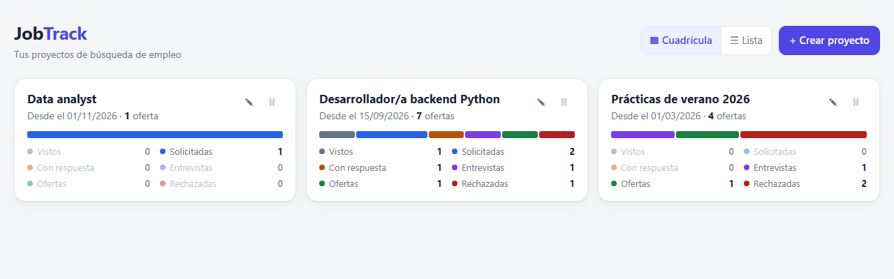
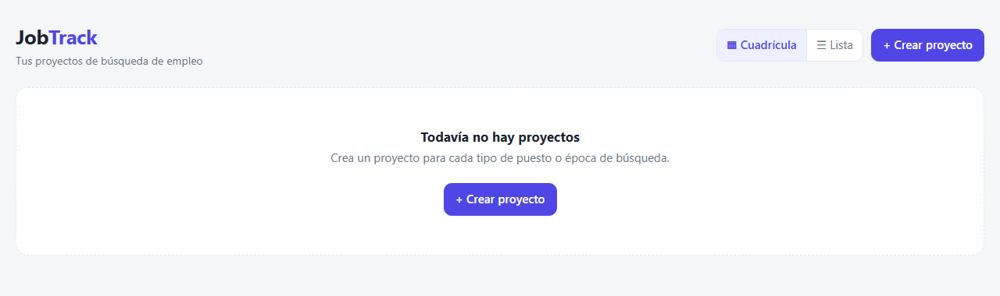
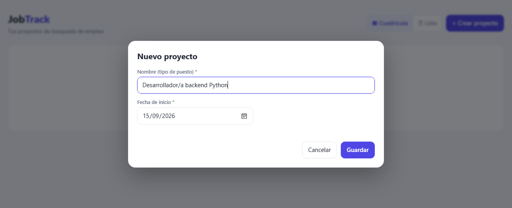
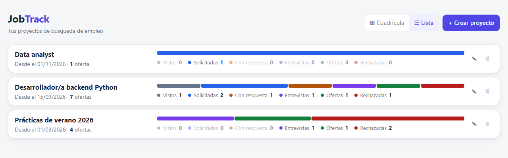
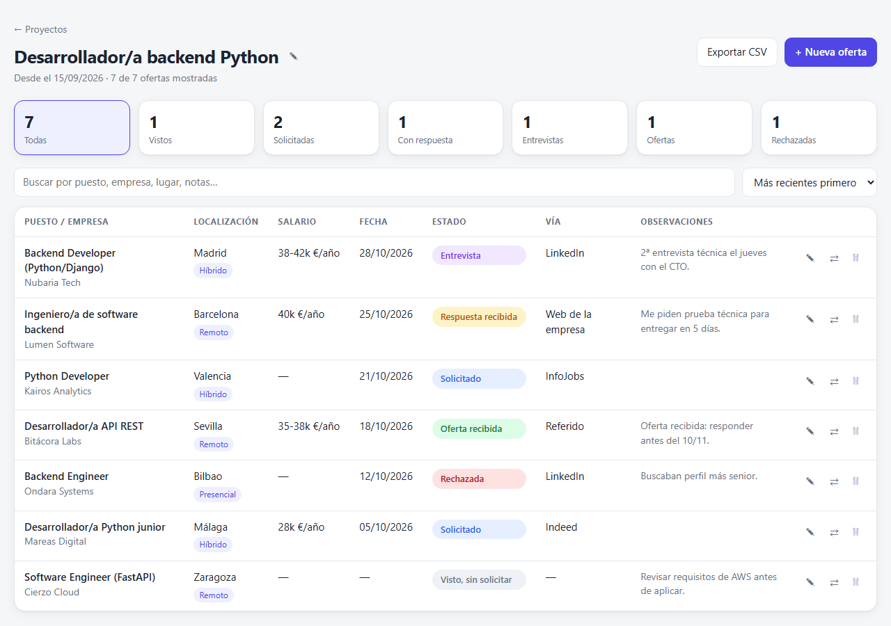
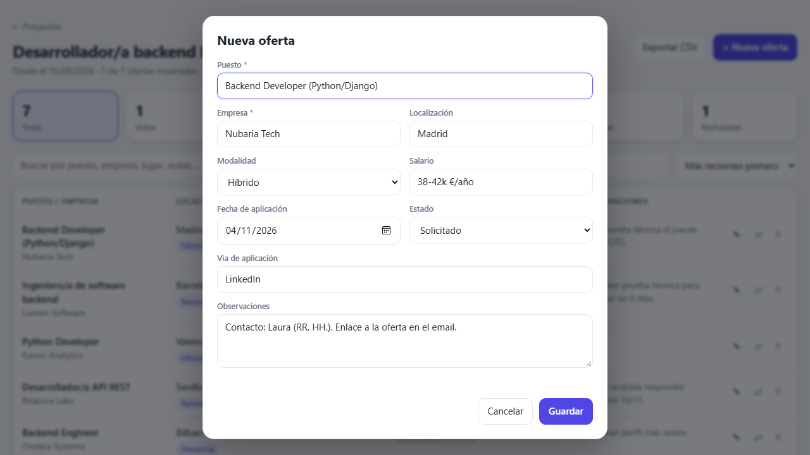
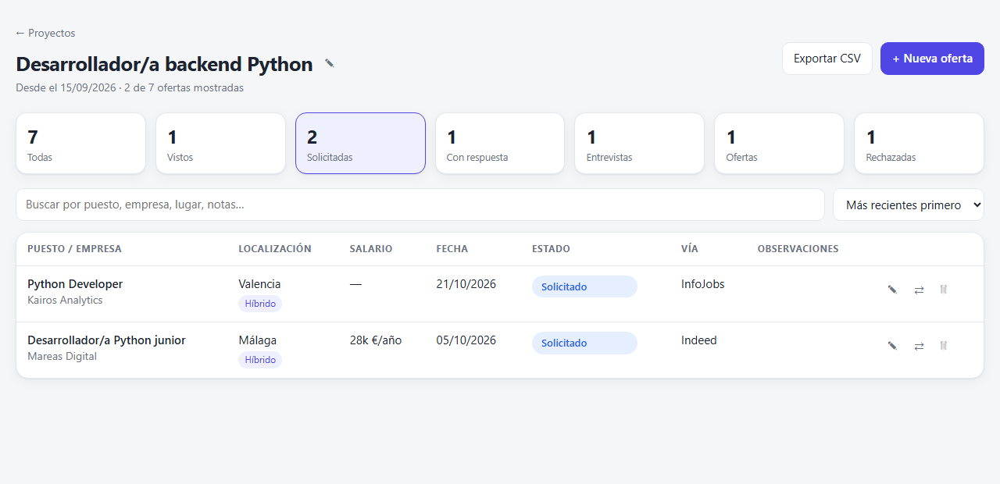
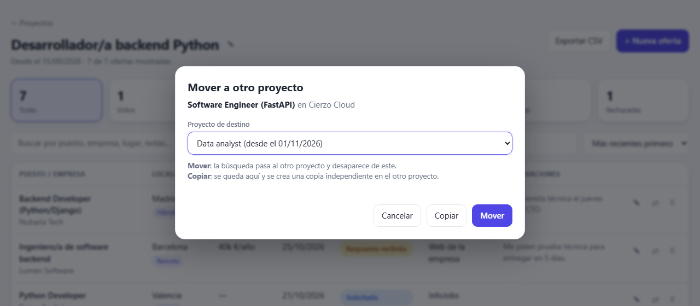

# JobTrack

Herramienta sencilla para llevar el **seguimiento de tus candidaturas de empleo**. Se ejecuta en tu ordenador y se usa desde el navegador.

- Organiza tus búsquedas en **proyectos** (por tipo de puesto o por época de búsqueda), cada uno con sus propias ofertas.
- Registra cada oferta con su puesto, empresa, localización, modalidad, salario, fecha, estado, vía de aplicación y observaciones.
- Ve de un vistazo cuántas ofertas tienes en cada estado: vistas, solicitadas, con respuesta, entrevistas, ofertas y rechazadas.
- Mueve o copia ofertas entre proyectos y exporta cualquier proyecto a CSV para abrirlo en Excel.
- **No necesita instalar nada** aparte de Python. Tus datos se guardan en un único archivo local (`jobtrack.db`) y no salen de tu ordenador.



---

## Índice

1. [Requisitos](#requisitos)
2. [Descargar el proyecto desde GitHub](#descargar-el-proyecto-desde-github)
3. [Instalación](#instalación)
4. [Ejecutar la herramienta](#ejecutar-la-herramienta)
5. [Guía de uso](#guía-de-uso)
6. [Tus datos y las copias de seguridad](#tus-datos-y-las-copias-de-seguridad)
7. [Solución de problemas](#solución-de-problemas)
8. [Estructura del proyecto](#estructura-del-proyecto)

---

## Requisitos

| Requisito | Detalle |
|---|---|
| **Python 3.8 o superior** | Es lo único necesario. JobTrack solo usa la librería estándar de Python. |
| **Un navegador moderno** | Chrome, Edge, Firefox o Safari, en una versión reciente. |
| **Git** *(opcional)* | Solo si quieres descargar el proyecto con `git clone`. |

Para comprobar qué versión de Python tienes, abre una terminal (en Windows, *PowerShell* o *Símbolo del sistema*) y ejecuta:

```bash
python --version
```

Si no lo tienes, descárgalo desde [python.org/downloads](https://www.python.org/downloads/). En Windows, marca la casilla **"Add python.exe to PATH"** durante la instalación.

---

## Descargar el proyecto desde GitHub

El repositorio está en **https://github.com/nachoigea/jobtrack**. Puedes descargarlo de dos formas.

### Opción A: con Git (recomendada)

Así podrás actualizarlo fácilmente más adelante.

```bash
git clone https://github.com/nachoigea/jobtrack.git
cd jobtrack
```

Para descargar las novedades en el futuro, ejecuta dentro de la carpeta:

```bash
git pull
```

### Opción B: descargar un ZIP (sin Git)

1. Abre https://github.com/nachoigea/jobtrack en el navegador.
2. Pulsa el botón verde **`<> Code`** y elige **Download ZIP**.
3. Descomprime el ZIP en la carpeta que quieras, por ejemplo `Documentos\jobtrack`.

> Si el repositorio es privado, necesitarás que su propietario te dé acceso y tendrás que haber iniciado sesión en GitHub.

---

## Instalación

**No hay que instalar nada más.** JobTrack no tiene dependencias externas, así que no hace falta `pip install` ni crear un entorno virtual. Con tener Python y la carpeta del proyecto es suficiente.

La primera vez que lo ejecutes, se creará automáticamente el archivo de datos `jobtrack.db` en la carpeta del proyecto.

---

## Ejecutar la herramienta

Desde la carpeta del proyecto:

```bash
python jobtrack.py
```

> En macOS y Linux puede que tengas que escribir `python3` en lugar de `python`. En Windows también funciona `py jobtrack.py`.

Verás algo así en la terminal:

```
JobTrack funcionando en http://127.0.0.1:8765  (Ctrl+C para cerrar)
Datos guardados en: C:\...\jobtrack\jobtrack.db
```

El navegador se abrirá solo con la herramienta. Si no se abre, entra manualmente en **http://127.0.0.1:8765**.

**Para cerrar JobTrack**, vuelve a la terminal y pulsa **`Ctrl + C`**. Todo lo que hayas guardado se conserva.

### Opciones

| Comando | Para qué sirve |
|---|---|
| `python jobtrack.py --port 9000` | Usa otro puerto, por ejemplo si el 8765 está ocupado. |
| `python jobtrack.py --no-browser` | Arranca sin abrir el navegador automáticamente. |
| `python jobtrack.py --help` | Muestra la ayuda. |

> JobTrack solo escucha en `127.0.0.1`, así que **únicamente se puede acceder desde tu propio ordenador**.

---

## Guía de uso

### 1. Pantalla de inicio: tus proyectos

Al abrir JobTrack verás la lista de **proyectos de búsqueda**. Un proyecto agrupa las ofertas de una búsqueda concreta. Por ejemplo: *"Desarrollador/a backend Python"*, *"Prácticas de verano 2026"* o *"Búsqueda tras el máster"*. Las ofertas de un proyecto no se mezclan con las de otro.

La primera vez la lista estará vacía:



### 2. Crear un proyecto

Pulsa **"+ Crear proyecto"** e indica:

- **Nombre:** el tipo de puesto al que quieres aplicar.
- **Fecha de inicio:** cuándo empiezas esta búsqueda. Por defecto es la fecha de hoy.



Al pulsar **Guardar** entrarás directamente en el proyecto para empezar a añadir ofertas.

### 3. Resumen de los proyectos: cuadrícula o lista

Cuando tengas proyectos, la pantalla de inicio muestra cada uno con su fecha de inicio, su número total de ofertas y un **resumen gráfico por estado**:

- Una **barra de colores** en la que cada tramo es proporcional al número de ofertas en ese estado. Al pasar el ratón por encima de un tramo verás el número exacto y el porcentaje.
- Una **leyenda** con el número de ofertas de cada estado. Los estados sin ofertas aparecen atenuados.

Con el selector **▦ Cuadrícula / ☰ Lista** de la parte superior puedes cambiar la forma de verlos. JobTrack recuerda tu elección.

**Vista en cuadrícula:**


**Vista en lista:**



Haz clic en un proyecto para abrirlo. Con los botones de cada tarjeta puedes:

- **✎ Editar** el nombre o la fecha de inicio del proyecto.
- **🗑 Eliminar** el proyecto. Se pedirá confirmación y **se borrarán también todas sus ofertas**.

### 4. Dentro de un proyecto: las ofertas



De arriba abajo encontrarás:

- **← Proyectos:** vuelve a la pantalla de inicio. También funciona el botón *atrás* del navegador.
- **El nombre del proyecto** con **✎**, para editarlo desde aquí.
- **Exportar CSV:** descarga las ofertas del proyecto en un archivo `.csv` que puedes abrir con Excel, LibreOffice o Google Sheets.
- **+ Nueva oferta:** añade una oferta a este proyecto.
- **Contadores por estado:** muestran cuántas ofertas hay en cada estado y además funcionan como filtros (ver el [punto 6](#6-buscar-filtrar-y-ordenar)).
- **El buscador y el orden de la lista.**
- **La tabla de ofertas.** En cada fila puedes:
  - **cambiar el estado directamente** con el desplegable de color de la columna *Estado*, sin abrir el formulario;
  - **✎ editar** la oferta;
  - **⇄ moverla o copiarla** a otro proyecto (ver el [punto 7](#7-mover-o-copiar-una-oferta-a-otro-proyecto));
  - **🗑 eliminarla**, tras confirmar.

### 5. Añadir o editar una oferta

Pulsa **"+ Nueva oferta"**, o **✎** en una oferta existente:



| Campo | Descripción |
|---|---|
| **Puesto** \* | Nombre del puesto. Obligatorio. |
| **Empresa** \* | Empresa que publica la oferta. Obligatorio. |
| **Localización** | Ciudad o país. |
| **Modalidad** | Presencial, Híbrido o Remoto. |
| **Salario** | Texto libre, por ejemplo `35-40k €/año`. |
| **Fecha de aplicación** | Por defecto, la fecha de hoy. Puedes dejarla vacía si aún no has aplicado. |
| **Estado** | En qué punto está la candidatura (ver la tabla siguiente). |
| **Vía de aplicación** | Email, web de la empresa, LinkedIn, InfoJobs… Puedes elegir una sugerencia o escribir otra. |
| **Observaciones** | Notas libres: contactos, enlaces, próximos pasos… |

**Los estados posibles son:**

| Estado | Cuándo usarlo |
|---|---|
| **Visto, sin solicitar** | Has visto la oferta pero todavía no has aplicado. |
| **Solicitado** | Has enviado tu candidatura. |
| **Respuesta recibida** | La empresa te ha contestado, por ejemplo con una prueba técnica o pidiendo más información. |
| **Entrevista** | Estás en proceso de entrevistas. |
| **Oferta recibida** | Te han hecho una oferta. |
| **Rechazada** | El proceso ha terminado sin éxito. |

### 6. Buscar, filtrar y ordenar

- **Filtrar por estado:** haz clic en uno de los contadores de la parte superior, por ejemplo *Solicitadas*, para ver solo esas ofertas. Pulsa **Todas** para quitar el filtro.
- **Buscar:** escribe en el buscador para filtrar por puesto, empresa, localización, vía, salario u observaciones.
- **Ordenar:** usa el desplegable de la derecha para ordenar por fecha (más recientes o más antiguas primero), por empresa o por estado.



### 7. Mover o copiar una oferta a otro proyecto

Si una oferta encaja mejor en otra búsqueda, pulsa **⇄ (Mover)** en su fila. Este botón solo aparece si tienes más de un proyecto. Elige el **proyecto de destino** y la acción:



- **Mover:** la oferta pasa al otro proyecto con todos sus datos y desaparece del actual.
- **Copiar:** la oferta se queda en el proyecto actual y se crea una copia en el de destino. Las dos copias son **independientes**: editar o borrar una no afecta a la otra.
- **Cancelar:** no hace nada.

Al terminar, un aviso en la parte inferior confirma la acción realizada.

---

## Tus datos y las copias de seguridad

- Todos los datos se guardan en **un único archivo, `jobtrack.db`** (una base de datos SQLite), situado en la misma carpeta que los scripts. Da igual desde qué carpeta lances el programa.
- **Para hacer una copia de seguridad**, copia ese archivo a otro sitio con JobTrack cerrado. **Para restaurarla**, vuelve a colocarlo en la carpeta del proyecto.
- **Para pasar tus datos a otro ordenador**, descarga allí el proyecto y copia tu `jobtrack.db` en la carpeta.
- Si borras `jobtrack.db`, JobTrack creará uno nuevo y vacío al arrancar.
- El archivo `jobtrack.db` **no se sube a GitHub**, porque está en el `.gitignore`. Tus datos son privados, pero eso también significa que GitHub no te sirve como copia de seguridad.

### Si vienes de una versión anterior (sin proyectos)

Las primeras versiones de JobTrack no tenían proyectos. Al abrir una base de datos antigua con la versión actual, la herramienta la **actualiza automáticamente**: todas las ofertas existentes pasan a un proyecto llamado **"Búsqueda inicial"**, con la fecha de la oferta más antigua como fecha de inicio. No se pierde ningún dato. Después puedes renombrar ese proyecto o mover sus ofertas a otros.

> Recomendación: antes de ejecutar una versión nueva por primera vez, haz una copia de `jobtrack.db`.

---

## Solución de problemas

| Problema | Solución |
|---|---|
| `No se pudo usar el puerto 8765 (¿JobTrack ya está abierto?)` | Probablemente ya tienes JobTrack abierto en otra terminal: usa esa ventana o ciérrala con `Ctrl + C`. También puedes arrancar en otro puerto con `python jobtrack.py --port 8766`. |
| `python` no se reconoce como comando | Python no está instalado o no está en el PATH. Prueba con `py` (Windows) o `python3` (macOS/Linux), o reinstala Python marcando *"Add python.exe to PATH"*. |
| El navegador no se abre solo | Abre manualmente http://127.0.0.1:8765, o el puerto que hayas elegido. |
| La página no carga o da error de conexión | Comprueba que la terminal donde lanzaste JobTrack sigue abierta. Si la cerraste, el servidor se detuvo. |
| `unable to open database file` al arrancar | La carpeta del proyecto no tiene permisos de escritura. Mueve el proyecto a una carpeta tuya, como Documentos. |
| Aparecen errores tras borrar `jobtrack.db` con JobTrack abierto | Cierra JobTrack (`Ctrl + C`) y vuelve a abrirlo. Las tablas se crean al arrancar. |

---

## Estructura del proyecto

```
jobtrack/
├── jobtrack.py    Punto de entrada: lee las opciones, prepara la BD y arranca el servidor
├── config.py      Configuración compartida: rutas, puerto, estados, rutas de la API
├── database.py    Base de datos SQLite: tablas, migración, validación y operaciones
├── servidor.py    Servidor HTTP y API REST que usa la página
├── interfaz.py    La página web completa (HTML + CSS + JavaScript)
├── docs/img/      Capturas de pantalla de este README
└── jobtrack.db    Tus datos (se crea al ejecutar; no está en el repositorio)
```

### API

La página se comunica con el servidor mediante una pequeña API JSON:

| Método | Ruta | Acción |
|---|---|---|
| `GET` | `/api/proyectos` | Lista los proyectos, con el total de ofertas y el recuento por estado. |
| `POST` | `/api/proyectos` | Crea un proyecto: `{"nombre", "fecha_inicio"}`. |
| `GET` / `PUT` / `DELETE` | `/api/proyectos/<id>` | Consulta, modifica o borra un proyecto. Al borrarlo se borran también sus ofertas. |
| `GET` / `POST` | `/api/proyectos/<id>/ofertas` | Lista las ofertas del proyecto o crea una nueva en él. |
| `PUT` / `DELETE` | `/api/ofertas/<id>` | Modifica o borra una oferta. |
| `POST` | `/api/ofertas/<id>/mover` | Mueve o copia la oferta a otro proyecto: `{"proyecto_id", "copiar": true/false}`. |
